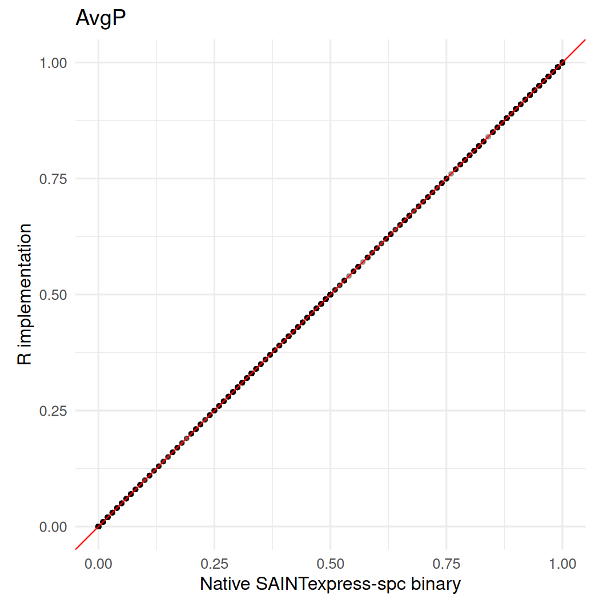
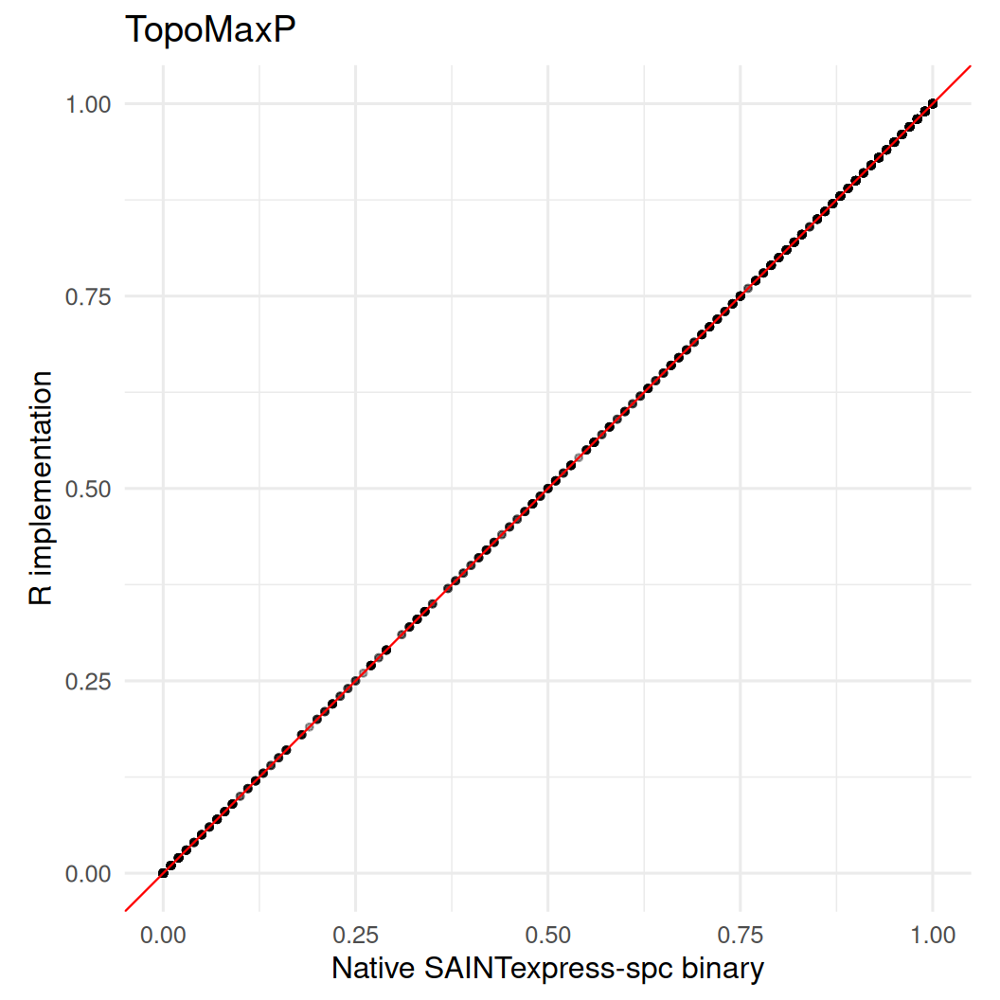
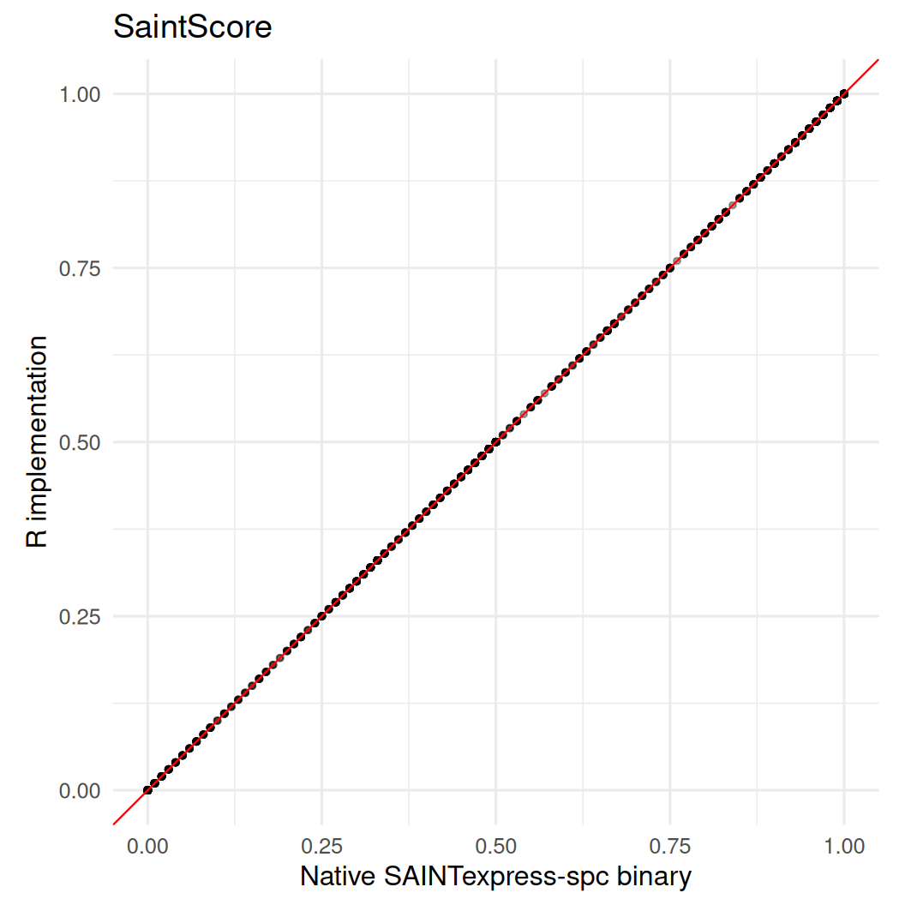
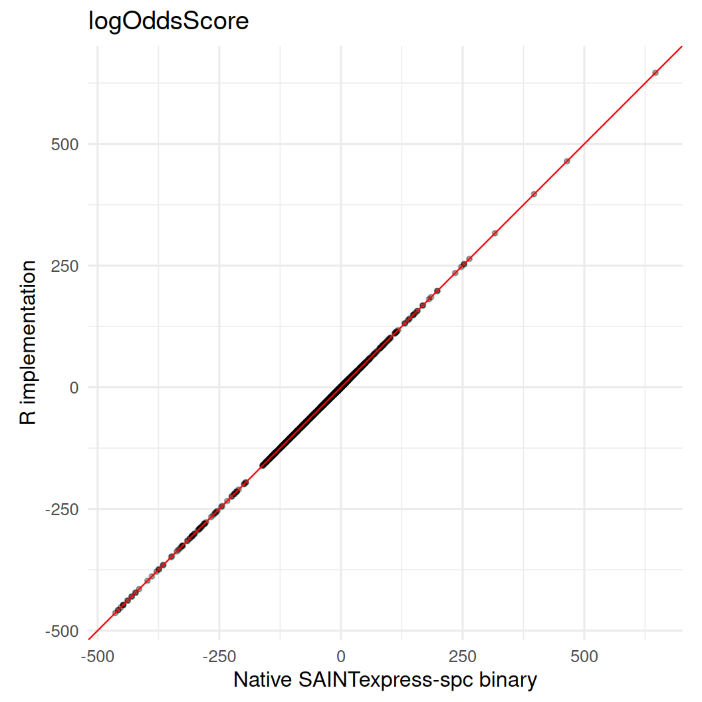
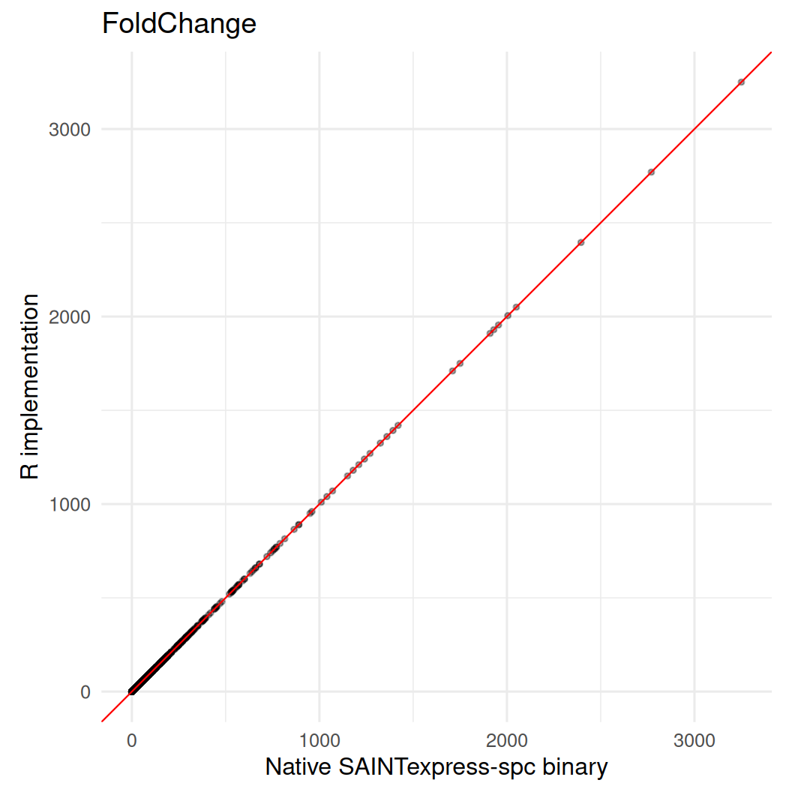
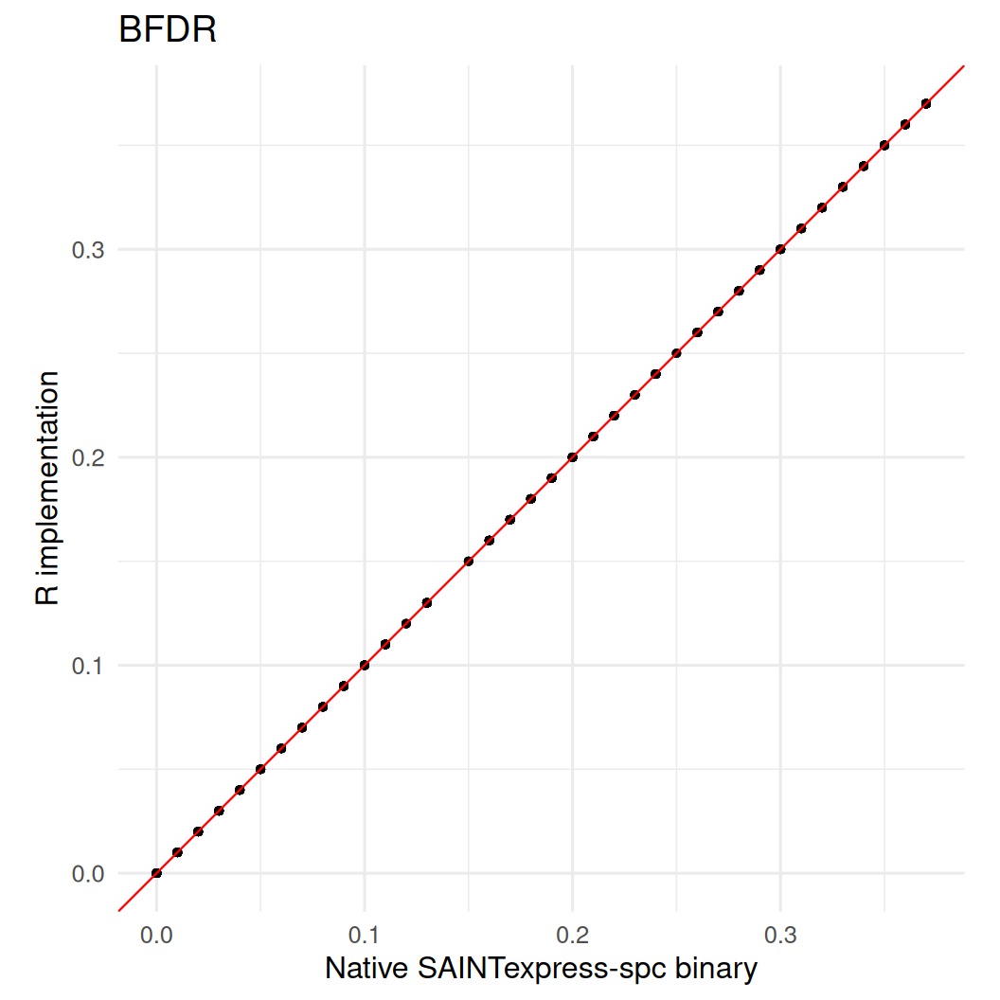

# SAINTexpress-spc: Native Binary vs R Implementation

``` r
fixture_dir <- system.file(
  "test/saintexpress-363-tip49-reference-spc",
  package = "prolfquasaint"
)
if (!nzchar(fixture_dir) && file.exists("inst/test/saintexpress-363-tip49-reference-spc")) {
  fixture_dir <- "inst/test/saintexpress-363-tip49-reference-spc"
}
if (!nzchar(fixture_dir) && file.exists("../inst/test/saintexpress-363-tip49-reference-spc")) {
  fixture_dir <- "../inst/test/saintexpress-363-tip49-reference-spc"
}
stopifnot(nzchar(fixture_dir))

si <- list(
  inter = read.delim(
    file.path(fixture_dir, "inter.dat"),
    header = FALSE,
    stringsAsFactors = FALSE,
    check.names = FALSE
  ),
  prey = read.delim(
    file.path(fixture_dir, "prey.dat"),
    header = FALSE,
    stringsAsFactors = FALSE,
    check.names = FALSE
  ),
  bait = read.delim(
    file.path(fixture_dir, "bait.dat"),
    header = FALSE,
    stringsAsFactors = FALSE,
    check.names = FALSE
  )
)
```

``` r
native_binary <- saintexpressbin::saintexpress_executable("spc")
stopifnot(nzchar(native_binary))
native_binary
#> [1] "/home/runner/work/_temp/Library/saintexpressbin/bin/Linux64/SAINTexpress-spc"
```

``` r
native_dir <- tempfile("saintexpress-native-")
dir.create(native_dir)

native <- prolfquasaint::runSaint(
  si,
  filedir = native_dir,
  spc = TRUE,
  engine = "binary",
  use_docker = FALSE,
  CLEANUP = TRUE
)$list

r_implementation <- prolfquasaint::runSaint(
  si,
  spc = TRUE,
  engine = "r",
  optimizer = "base"
)$list
```

``` r
key_cols <- c("Bait", "Prey", "PreyGene")
comparison <- merge(
  native,
  r_implementation,
  by = key_cols,
  suffixes = c("_binary", "_r")
)

numeric_cols <- c(
  "AvgP",
  "MaxP",
  "TopoAvgP",
  "TopoMaxP",
  "SaintScore",
  "logOddsScore",
  "FoldChange",
  "BFDR"
)

summary_table <- data.frame(
  metric = numeric_cols,
  n = integer(length(numeric_cols)),
  correlation = numeric(length(numeric_cols)),
  mean_abs_delta = numeric(length(numeric_cols)),
  max_abs_delta = numeric(length(numeric_cols))
)

for (i in seq_along(numeric_cols)) {
  metric <- numeric_cols[[i]]
  binary_values <- comparison[[paste0(metric, "_binary")]]
  r_values <- comparison[[paste0(metric, "_r")]]
  complete <- complete.cases(binary_values, r_values)
  delta <- r_values[complete] - binary_values[complete]
  summary_table$n[[i]] <- sum(complete)
  summary_table$correlation[[i]] <- cor(binary_values[complete], r_values[complete])
  summary_table$mean_abs_delta[[i]] <- mean(abs(delta))
  summary_table$max_abs_delta[[i]] <- max(abs(delta))
}

summary_table
#>         metric    n correlation mean_abs_delta max_abs_delta
#> 1         AvgP 5521           1   0.000000e+00          0.00
#> 2         MaxP 5521           1   0.000000e+00          0.00
#> 3     TopoAvgP 5521           1   0.000000e+00          0.00
#> 4     TopoMaxP 5521           1   0.000000e+00          0.00
#> 5   SaintScore 5521           1   0.000000e+00          0.00
#> 6 logOddsScore 5521           1   1.992393e-05          0.01
#> 7   FoldChange 5521           1   0.000000e+00          0.00
#> 8         BFDR 5521           1   0.000000e+00          0.00
```

``` r
for (metric in numeric_cols) {
  binary_col <- paste0(metric, "_binary")
  r_col <- paste0(metric, "_r")
  plot_data <- comparison[complete.cases(comparison[c(binary_col, r_col)]), ]
  range_values <- range(c(plot_data[[binary_col]], plot_data[[r_col]]), finite = TRUE)

  cat("##", metric, "\n\n")
  print(
    ggplot2::ggplot(
      plot_data,
      ggplot2::aes(x = .data[[binary_col]], y = .data[[r_col]])
    ) +
      ggplot2::geom_point(alpha = 0.35, size = 1) +
      ggplot2::geom_abline(slope = 1, intercept = 0, color = "red", linewidth = 0.4) +
      ggplot2::coord_equal(xlim = range_values, ylim = range_values) +
      ggplot2::labs(
        x = "Native SAINTexpress-spc binary",
        y = "R implementation",
        title = metric
      ) +
      ggplot2::theme_minimal(base_size = 12)
  )
  cat("\n\n")
}
```

## AvgP



## MaxP


## TopoAvgP


## TopoMaxP



## SaintScore



## logOddsScore



## FoldChange



## BFDR



## Session information

``` r
sessionInfo()
#> R version 4.6.2 (2026-10-29)
#> Platform: x86_64-pc-linux-gnu
#> Running under: Ubuntu 26.04.1 LTS
#> 
#> Matrix products: default
#> BLAS:   /usr/lib/x86_64-linux-gnu/openblas-pthread/libblas.so.3 
#> LAPACK: /usr/lib/x86_64-linux-gnu/openblas-pthread/libopenblasp-r0.3.32.so;  LAPACK version 3.12.0
#> 
#> locale:
#>  [1] LC_CTYPE=C.UTF-8       LC_NUMERIC=C           LC_TIME=C.UTF-8       
#>  [4] LC_COLLATE=C.UTF-8     LC_MONETARY=C.UTF-8    LC_MESSAGES=C.UTF-8   
#>  [7] LC_PAPER=C.UTF-8       LC_NAME=C              LC_ADDRESS=C          
#> [10] LC_TELEPHONE=C         LC_MEASUREMENT=C.UTF-8 LC_IDENTIFICATION=C   
#> 
#> time zone: UTC
#> tzcode source: system (glibc)
#> 
#> attached base packages:
#> [1] stats     graphics  grDevices utils     datasets  methods   base     
#> 
#> loaded via a namespace (and not attached):
#>  [1] bit_4.6.0             gtable_0.3.6          limma_3.68.5         
#>  [4] jsonlite_2.0.0        crayon_1.5.3          dplyr_1.2.1          
#>  [7] compiler_4.6.2        tidyselect_1.2.1      Rcpp_1.1.2           
#> [10] parallel_4.6.2        tidyr_1.3.2           saintexpressbin_0.0.1
#> [13] scales_1.4.0          yaml_2.3.12           fastmap_1.2.0        
#> [16] statmod_1.5.2         readr_2.2.0           ggplot2_4.0.4        
#> [19] R6_2.6.1              labeling_0.4.3        generics_0.1.4       
#> [22] knitr_1.52            MASS_7.3-66           ggrepel_0.9.8        
#> [25] tibble_3.3.1          SAINTexpress_1.0.0    tzdb_0.5.0           
#> [28] pillar_1.11.1         RColorBrewer_1.1-3    rlang_1.3.0          
#> [31] prolfquasaint_0.99.0  xfun_0.62             S7_1.0.0             
#> [34] bit64_4.8.6           otel_0.3.0            prolfqua_1.9.10      
#> [37] cli_3.6.6             withr_3.0.3           magrittr_2.0.5       
#> [40] digest_0.6.39         grid_4.6.2            vroom_1.7.1          
#> [43] hms_1.1.4             lifecycle_1.0.5       vctrs_0.7.3          
#> [46] evaluate_1.0.5        glue_1.8.1            farver_2.1.2         
#> [49] purrr_1.2.2           rmarkdown_2.32        tools_4.6.2          
#> [52] pkgconfig_2.0.3       htmltools_0.5.9
```
